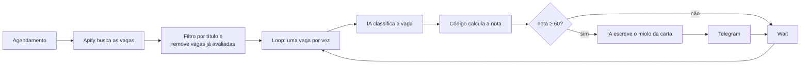
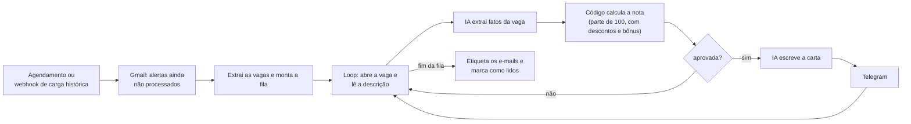
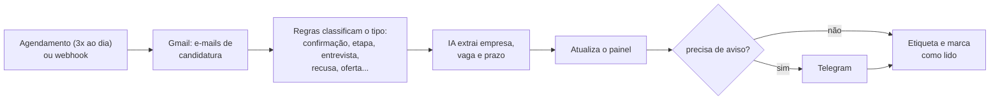

# Automação de busca de vagas com n8n

Estava assistindo a alguns vídeos sobre automação de envio de currículos e encontrei o vídeo da [Rafa Ballerini](https://www.youtube.com/@rafaellaballerini), que ensina a montar uma busca de vagas com o n8n. Gostei da ideia, segui o tutorial dela e adaptei para o meu uso: mudei a forma de avaliar as vagas e criei dois workflows novos, um que lê os alertas de vagas do Gmail e outro que acompanha as respostas das candidaturas. Os links do vídeo e dos repositórios dela estão na seção [Créditos](#créditos).

Três workflows de [n8n](https://n8n.io) que automatizam a minha busca por vaga de TI (estágio e júnior): um busca vagas no LinkedIn, outro lê os alertas de vagas que chegam no Gmail e o terceiro acompanha as respostas das candidaturas. Tudo avisa pelo Telegram e usa IA (Groq) onde regra simples não resolve.

Montei para economizar tempo e dinheiro: roda no meu computador, em Docker, e usa o plano gratuito do Groq. A seção [Decisões de custo](#decisões-de-custo) explica o que adaptei para isso.

> **Aviso:** os workflows deste repositório estão sem credenciais e com o perfil em branco. Antes de usar, siga a seção [Instalação](#instalação).

## Os 3 workflows

| # | Arquivo | O que faz | Quando roda (padrão) |
|---|---------|-----------|----------------------|
| 01 | `workflows/01-linkedin-find-a-job.json` | Busca vagas no LinkedIn pelo Apify, avalia a aderência ao seu perfil com IA e manda no Telegram com uma sugestão de carta | Diário, 15h |
| 02 | `workflows/02-vagas-por-email.json` | Lê os alertas de vagas do Gmail (LinkedIn, Glassdoor, Indeed), pontua cada vaga e manda as compatíveis no Telegram | Diário, 17h, e carga histórica por webhook |
| 03 | `workflows/03-candidaturas.json` | Lê as respostas das candidaturas no Gmail, mantém um painel e avisa quando precisa de ação (etapa, entrevista) | 3 vezes ao dia (9h30, 14h30, 20h30), carga histórica e painel por webhook |

Os horários são o padrão que eu uso; troque no nó **Schedule Trigger** de cada um.

## Como cada um funciona

### 01 · LinkedIn Automatic Find a Job

A IA só **classifica** (nível, área, requisitos atendidos e faltantes). A **nota é calculada no código**, sempre pela mesma regra, com tetos para descrição curta, vaga pleno/sênior, fora de TI e fora da região. Assim a mesma vaga não muda de nota de um dia para o outro.

### 02 · Vagas por Email

### 03 · Candidaturas

O tipo do e-mail vem de **regras de texto**, não da IA. A IA só extrai empresa, vaga e prazo. O painel fica numa página servida pelo próprio n8n.

## Requisitos

- **n8n** (eu uso local, com Docker).
- **Telegram**: um bot por workflow (criado no [@BotFather](https://t.me/BotFather)) e o seu chat ID.
- **Groq**: chave de API do plano gratuito.
- **Apify**: token (só para o workflow 01).
- **Google Cloud**: projeto com a Gmail API e credencial OAuth (workflows 02 e 03). Publique o app como **Em produção**; em modo de teste o acesso ao Gmail expira a cada 7 dias.

Como criar as chaves do Apify, Groq e Telegram e adicioná-las no n8n está bem explicado em [CredenciaisVagasDeEmprego](https://github.com/rafaballerini/CredenciaisVagasDeEmprego).

## Instalação

1. No n8n, em um workflow novo: **⋯ → Import from file…** e escolha um dos JSONs de `workflows/`.
2. Em cada nó que mostrar alerta, **selecione a sua credencial** (Gmail, Telegram, Groq, Apify). Os arquivos vêm sem nenhuma.
3. Preencha os marcadores abaixo.
4. Em **Settings** do workflow, confira o fuso horário (`America/Sao_Paulo`).
5. Teste com **Execute workflow**, uma vez, e só então **Publish**.

### O que preencher

| Marcador | Onde | O que colocar |
|----------|------|---------------|
| `SEU_CHAT_ID_DO_TELEGRAM` | nós de Telegram, nos 3 | o seu chat ID |
| `<<PREENCHA COM OS SEUS DADOS>>` | prompts dos nós **Basic LLM Chain** (01 e 02) | o seu perfil: busca, formação, habilidades, o que você **não** tem, projeto, experiência, local |
| `<<PREENCHA>>` | prompt da carta, nó **Basic LLM Chain1** (01 e 02) | habilidades, projeto e experiência reais |
| `SEU NOME`, `SUA FORMAÇÃO`, `SEU-USUARIO` | nó **Montar mensagem** (01); nó **Send a text message** e prompt da carta (02) | nome, formação e usuário do GitHub |
| `ID_DA_ETIQUETA_TRABALHO`, `ID_DA_ETIQUETA_VAGAS_PROCESSADO`, `ID_DA_ETIQUETA_CANDIDATURAS` | nós Gmail de etiquetar (02 e 03) | crie as etiquetas no Gmail e pegue os IDs: nó Gmail → Label → **Get Many** |
| `ANO_FORMATURA`, `SALARIO_MINIMO` | nó **Code in JavaScript1** (02) | sua previsão de formatura e o salário mínimo que aceita (0 desliga o aviso) |
| palavras-chave e cidade | nó **Apify** (01) e filtros de título no primeiro nó de código | a sua busca |

No workflow 02 o perfil aparece em **dois** nós (o principal e o de reserva); preencha os dois iguais.

## Carga histórica (backfill)

Com o workflow **publicado**, abra no navegador. Faça uma por vez, para não estourar o limite da IA.

- **02**: `http://localhost:5678/webhook/vagas-email-backfill?dias=60` (ou `?inicio=AAAA/MM/DD&fim=AAAA/MM/DD`). Analisa 50 vagas por execução; o resto fica na fila e sai nas execuções diárias.
- **03**: `http://localhost:5678/webhook/candidaturas-backfill?dias=90` (ou `?inicio=AAAA/MM/DD&fim=AAAA/MM/DD`).
- **03, painel**: `http://localhost:5678/webhook/candidaturas`.
- **03, utilitário**: `.../webhook/candidaturas-etiquetar-historico` aplica as etiquetas nos e-mails que já tinham sido analisados antes de existir a etiquetagem. Serve uma vez só.

## Decisões de custo

O objetivo foi gastar o mínimo possível. O que adaptei em relação ao tutorial original:

- **Sem hospedagem paga:** o n8n roda local em Docker. O computador fica ligado nos horários dos agendamentos.
- **Groq no plano gratuito:** o limite é **por modelo** (200 mil tokens por dia no `gpt-oss-20b`) e uma avaliação gasta cerca de 2,4 mil tokens. Por isso:
  - o modelo menor faz o volume (classificar) e o maior escreve as cartas, que são poucas;
  - a etapa de avaliação tem um **modelo reserva** (no 01, a carta também): se um modelo estoura o limite do dia, o outro assume.
- **IA só onde precisa:** a nota é calculada em código, e no workflow 03 o tipo do e-mail vem de regex; a IA só extrai empresa, vaga e prazo.
- **Menos chamadas à IA:**
  - filtro por título antes de qualquer chamada;
  - limite de vagas por execução (20 no 01, 50 no 02, 100 e-mails no 03);
  - memória entre execuções, para nunca avaliar a mesma vaga duas vezes.
- **Wait entre itens** (30 s nos workflows de vagas, 8 s no 03), para não passar do limite de tokens por minuto. Em troca, 20 vagas levam cerca de 15 minutos e 100 e-mails, cerca de meia hora.
- **Apify:** o ator cobra pelo uso. O `limitPerSource` (100) limita o gasto; confira no console do Apify quanto cada execução consome na sua conta.

## Limitações e cuidados

- **Revise antes de aplicar.** A IA pode errar a vaga ou a carta. Os prompts proíbem inventar habilidades, mas a conferência final é sua.
- **A memória só grava em execução real** (agendada ou por webhook com o workflow publicado). Teste manual não grava, então vagas já vistas podem aparecer de novo ao testar.
- **LinkedIn:** a busca usa um ator de terceiros no Apify. Use para fins pessoais e confira os termos de uso do LinkedIn e do ator.
- **Limite diário do Groq:** se estourar, o dia seguinte libera. Vaga que falha por erro da IA não é marcada como vista e volta na próxima execução.
- **Nunca suba credenciais, chat IDs ou IDs de etiquetas** para um repositório. Veja como atualizo estes arquivos sem vazar nada em [docs/ATUALIZANDO-OS-WORKFLOWS.md](docs/ATUALIZANDO-OS-WORKFLOWS.md).

## Versões

O histórico de mudanças está no [CHANGELOG.md](CHANGELOG.md).

## Créditos

O workflow 01 nasceu do tutorial da **Rafa Ballerini**. Sem o vídeo e os repositórios dela eu não teria começado:

- Canal: [youtube.com/@rafaellaballerini](https://www.youtube.com/@rafaellaballerini)
- Vídeo: [youtube.com/watch?v=sq8ThaXkp7k](https://www.youtube.com/watch?v=sq8ThaXkp7k)
- Códigos e textos do tutorial: [rafaballerini/CodigosBuscaDeEmpregoN8N](https://github.com/rafaballerini/CodigosBuscaDeEmpregoN8N)
- Como adicionar as credenciais: [rafaballerini/CredenciaisVagasDeEmprego](https://github.com/rafaballerini/CredenciaisVagasDeEmprego)

A partir dessa base eu adaptei o 01 e construí o 02 e o 03.

## Licença

Distribuído sob a licença [MIT](LICENSE). Os repositórios da Rafa Ballerini não declaram licença; por isso este projeto não copia o material dela e traz só as minhas adaptações, com os créditos acima.

## Autor

Feito por [Micael Fabri](https://github.com/micaelfabri), com o Claude (Anthropic) como assistente de programação e documentação.
